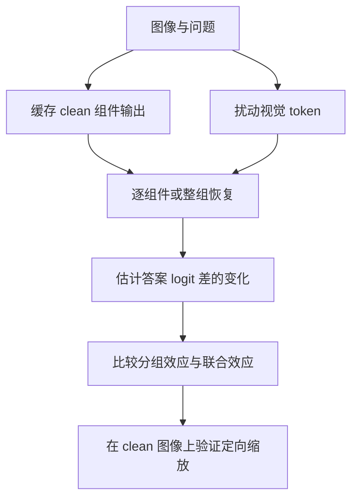

# Dual-Pathway Circuits of Object Hallucination in Vision-Language Models

NeurIPS 2026 PosterMechanistic interpretabilityComponent / pathway已精读

[arXiv v2](https://arxiv.org/abs/2605.13156v2){ .kb-button .primary } [官方 Poster](https://neurips.cc/virtual/2026/poster/154151){ .kb-button } [官方代码](https://github.com/jiaxin26/DualPath-VLM/tree/c1cf59e6b632db25bddec34a6f3a8578788e75e0){ .kb-button }

<strong>一句话总结</strong>
作者在五种 VLM 中发现，在高斯破坏背景下恢复同一组 grounding 组件，平均效果会从支持正确答案转向支持原先的错误答案。缩放另一组组件后，论文报告 POPE-adversarial 假阳性率相对下降 40%–76%，但公开脚本的默认样本划分与论文声明不一致。

!!! note "2026-11-19 版本复核"
    [v2](https://arxiv.org/pdf/2605.13156v2)（2026-10-07）补入官方代码链接，并调整通讯作者、参考文献与排版。对照[v1](https://arxiv.org/pdf/2605.13156v1)（2026-05-13），未发现主实验协议和附录 Tables 12–14 数值变化。双路径、CPA 和 grounding 极性翻转均已见 v1。会议官网列为 NeurIPS 2026 Poster，技术细节和表格以 arXiv v2 为准，正式论文集版本尚待对照。

## 官方方法概览图

<figure class="paper-figure"><figcaption>Jiaxin Liu 等，官方方法总览（<a href="https://arxiv.org/pdf/2605.13156v1">arXiv v1</a> Figure 1，第 3 页，裁切自 PDF，<a href="https://creativecommons.org/licenses/by/4.0/">CC BY 4.0</a>）。v2 Figure 1 仍展示同样的输入、破坏和恢复流程。</figcaption></figure>

对图像—问题对先运行 clean pass，缓存 attention/MLP 输出。向注入语言模型的视觉向量加入高斯噪声，再逐组件把缓存的 clean activation 写回 corrupt pass。最后比较两个答案 token 的 logit 差，估计该组件在破坏背景下可恢复的答案证据。

## 1. 论文速览

| 维度 | 内容 |
|---|---|
| 研究对象 | POPE 二元物体存在判断，干预结果也评估 AMBER existence、attribute、relation |
| 输入与输出 | 图像、问题和参照答案，输出 clean/corrupt/patched 对比、组件集合和缩放后的 yes/no |
| 干预位置 | 语言模型各层 attention / MLP 子层的输出，本论文主分析采用整个组件粒度 |
| 方法类型 | Activation patching 机制分析，推理时统一缩放作为因果检验 |
| 外部依赖 | 模型内部 hook、POPE 标签和 COCO 图像。作者报告的主流程无需单独检测器或 LLM evaluator |
| 最适合角色 | 联合路径恢复、组件定位、同数量随机缩放及保召回对照的机制 baseline |

## 2. 研究背景与核心矛盾

逐个恢复组件可找出候选，但某个组件在正确样本支持视觉答案，无法决定它在幻觉样本中做什么。论文分别检验组件的作用方向，以及联合恢复能否得到个体恢复相加所预测的效果。

| 假设 | 论文证据 | 证据类型 | 仍可能的混淆因素 |
|---|---|---|---|
| 两组组件的答案贡献分布与深度不同 | 五模型使用相同组件筛选准则，发现 26–48 个显著组件 | 带人工扰动的反事实干预 | 高斯噪声与自然视觉证据缺失的分布差异，归一化分母的大小 |
| Grounding 路径在错误样本仍起作用，平均方向翻转 | CPA 中五个模型均观察到平均 IE 变号，Figure 3 / Table 12 | 联合恢复和输出分组 | clean logit 同时参与分组与被恢复状态。需匹配 clean margin，并比较标签、误差类型和文本先验 |
| 压低 hallucination 路径可减少假阳性 | Table 13 的定向缩放和 Table 3 的随机缩放对照 | 干预正常前向图 | 回答阈值或解码解析变化也可压低假阳性。需核实公开脚本的样本隔离 |

## 3. 方法详解

**单组件定位。** 令 $\Delta$ 为最后一个输入 token 处「正确答案 token 减错误答案 token」的 logit 差。对于第 $L$ 层、类型 $C$ 的子层输出，$IE(L,C)=\Delta_{\rm patched}(L,C)-\Delta_{\rm corrupt}$ 衡量恢复所改善的答案边际，$TE=\Delta_{\rm clean}-\Delta_{\rm corrupt}$ 衡量整体破坏的变化。官方代码在发现阶段计算 $IE/|TE|$，当 $|TE|<10^{-8}$ 时返回零，组件分数形成 $[n_{\rm layers},2]$。两类按 clean 答案正确性划分，对归一化 IE 做 Welch 检验、Benjamini–Hochberg 校正并要求 $p_{\rm adj}<.05$ 且 $|d|>.3$。$d>0$ 的组件划为 grounding，$d<0$ 划为 hallucination。

**联合恢复。** 对 $k$ 个组件构成的集合 $\mathcal P$，$IE(\mathcal P)$ 来自一次同时恢复。§3.3 Eqs. 2–4 进一步报告 $\mathrm{Interaction}=IE(\mathcal P)-\sum_i IE(C_i)$ 与 $\mathrm{MagDiff}=|IE(\mathcal P)|-\sum_i|IE(C_i)|$，分别对应有符号非加性和幅度非加性。样本路径包含共同的后续非线性与输出瓶颈，因此幅度低于相加预测可有多种来源。只在单个 clean margin 上观察到小比率，无法区分同一信息的冗余拷贝、符号抵消、函数饱和或多条路径共用下游组件。

**基线与干预。** 论文对选中组件输出 $h$ 应用 $h'=sh$，$s\in\{0,.25,.5,.75\}$，LLaVA 按 $\lvert d\rvert$ 选择 top-$k$。Logit lens 以最终 norm 和 LM head 解码每层末位置状态，仅用作读出对照。作者还将统一缩放与随机组件缩放、一维均值差投影、probe-based ITI 比较。基础组件扫描每个样本约需两次基准前向加每组件一次恢复前向；联合恢复每条路径另需一次。附录 A 报告在 H200 144GB 上 1,000 条发现样本约需每模型 2–18 小时，400 条 CPA 再需约 2–3 小时。

## 4. 实验设计与关键结果

### 4.1 设置

| 项目 | 内容 |
|---|---|
| 模型 | Qwen3-VL-8B、LLaVA-v1.6-Mistral-7B、Llama-3.2-Vision-11B、InternVL3-8B/14B，模型 ID 见附录 A |
| 论文样本设定 | POPE-adversarial：发现 1,000、CPA 400、logit lens 200、干预选择 100 和测试 400；按 §4 的声明独立抽取。公开默认实现的差异见第 6 节 |
| 推理配置 | 高斯扰动标准差为每条样本视觉向量标准差的 3 倍；论文使用 greedy，公开干预脚本可见 yes/no 后缀及默认 `max_new_tokens=5` |
| 指标 | Acc 与负样本假阳性率 FPR；正例召回、无法解析比例及误改对需要额外审计 |
| 统计 | 组件发现使用 BH 控制；附录 C 的 CPA 与 logit lens 检验报告未校正 p 值；随机对照使用五个种子，主结果未给跨样本划分的重复试验或配对 CI |

### 4.2 主结果

论文报告的 POPE-adversarial 结果。Acc 越高越好，H 为负例 FPR，越低越好。相对变化的分母是该模型原始 H。

| 模型 | Baseline Acc / H | 缩放配置 | 方法后 Acc / H | H 绝对变化 / 相对降幅 | 来源 |
|---|---:|---|---:|---:|---|
| Qwen3-VL-8B | 88.2% / 8.4% | 12 个组件，$s=.25$ | 87.2% / 4.0% | −4.4 pp / 52% | Table 13 / Figure 4 |
| LLaVA-v1.6-7B | 88.5% / 5.0% | top-10，$s=.5$ | 88.5% / 3.0% | −2.0 pp / 40% | Table 13 / Figure 4 |
| Llama-3.2-V-11B | 84.8% / 18.4% | 20 个组件，$s=.5$ | 84.6% / 4.4% | −14.0 pp / 76% | Table 13 / Figure 4 |
| InternVL3-8B | 88.4% / 15.6% | 6 个组件，$s=.5$ | 86.4% / 5.6% | −10.0 pp / 64% | Table 13 / Figure 4 |
| InternVL3-14B | 88.0% / 15.5% | 16 个组件，$s=.5$ | 87.8% / 9.0% | −6.5 pp / 42% | Table 13 / Figure 4 |

### 4.3 消融与分析实验

| 实验 | 关键结果 | 证据边界 | 来源 |
|---|---|---|---|
| 双路径与阈值 | 每模型 26–48 个显著组件，改变 $\lvert d\rvert$ 阈值到 .25/.35 后，20 个比较中 16 个 Jaccard ≥.80，最小 .60 | 使用相同扰动和发现数据，对阈值较稳健 | Figure 2 / Tables 1–2 |
| CPA | grounding 平均 IE 从正确组的 +.13 至 +1.59 转为错误组的 −1.08 至 −.07。20 个模型/路径/分组单元的联合/个体绝对值之和比率为 .07–.69 | 条件输出效应与非加性可观察，同一信息被重复编码仍需单独验证 | Figure 3 / Table 12 |
| 独立读出 | 四模型的 logit-lens 差异显著，Llama-3.2 的错误组差异 $d=-.18$、$p=.43$ | 用最终读出层解码中间状态会受 cross-attention 融合位置影响 | §5.3 / Table 10 |
| LLaVA top-$k$ | $k=3,5$ 的 H 从 5.0% 增至 6.5%，$k=8,10$ 降到 3.0%，全 30 个压至 1.5% 时 Acc 仅 79.5% | 多抑制未必提高总体表现，阈值选择和 FNR 需要同时报告 | Table 13 |
| 干预特异性 | 三模型的随机缩放均未降低 H，整条 grounding 路径置零使 Acc 约降至 50%–51% | 说明目标组件有功能作用，仍应在同层同类型预算和原模型能力上核查 | Tables 3、7 |
| ITI 与一维投影 | Table 3 统一缩放跨五模型平均降幅较大，但 InternVL3-8B 的 ITI 为 −11.0 pp、统一缩放为 −10.0 pp | 与附录 D.3 的「每模型均更小」文字不一致；两方法的 baseline 分属不同执行流程，比较不等于同协议显著性结论 | Table 3 / §D.3 |
| AMBER 迁移 | 关系题中三模型相对降约 36%–47%。属性题的 LLaVA 增 1.5 pp、Llama 降 9.5 pp、InternVL3-8B 降 8.6 pp | 迁移随能力和题型而变；该评测只保留负例，缺少召回信息 | Table 14 |

### 4.4 结果边界

论文以受控内部干预展示了组件作用和答案变化，并提供无需训练的因果检验。把极性翻转直接归因于语言先验仍需要文本反事实。把 POPE 的 FPR 收益带到开放图像描述还需要逐对象召回、长度、重复率与自由生成的检验。

## 5. 亮点与贡献

- 将单组件恢复、整组恢复和 clean 输入缩放结合，便于区分「可定位」「联合有效」及「干预后答案改变」。
- 在包含 projector 与 cross-attention 的四种融合结构中明确比较组件位置，并保留 Llama logit lens 的非显著案例。
- 表格同时给出准确率与假阳性率，LLaVA 的缩放深度消融也暴露出保召回或保总体能力需要的额外对照。

## 6. 局限、指标漏洞与审稿风险

1. **公开默认代码的独立划分缺口。** 官方 [reproduce.sh](https://github.com/jiaxin26/DualPath-VLM/blob/c1cf59e6b632db25bddec34a6f3a8578788e75e0/reproduce.sh) Phase 1 与 Phase 6 共享同一 POPE-adversarial 路径，分别取前 1,000 与前 500 个输入；[加载器](https://github.com/jiaxin26/DualPath-VLM/blob/c1cf59e6b632db25bddec34a6f3a8578788e75e0/experiments/benchmarks.py#L71-L122) 按文件顺序读取，[干预脚本](https://github.com/jiaxin26/DualPath-VLM/blob/c1cf59e6b632db25bddec34a6f3a8578788e75e0/experiments/run_intervention.py#L545-L574) 切出前 100 条用于选择、第 101–500 条用于评估。直接使用官方 README 的原始输入布局时，干预选择与评估条目均包含在发现输入中。论文实际使用的样本 ID 未取得，故无法判断论文原始实验是否重叠。应公布图像级 ID 清单，并在独立图像分组上重新验证。
2. **错误与幻觉的操作化不完全一致。** 论文 §3.2 用「不存在物体却回答 yes」描述分组，[patching 代码](https://github.com/jiaxin26/DualPath-VLM/blob/c1cf59e6b632db25bddec34a6f3a8578788e75e0/patching/core.py#L426-L444) 以 clean 正误分组，[CPA 入口](https://github.com/jiaxin26/DualPath-VLM/blob/c1cf59e6b632db25bddec34a6f3a8578788e75e0/experiments/run_pathway_patching.py#L183-L212) 同时读正、负标签。若直接喂入混合样本，假阴性也落入代码的 hallucination 组。报告机制时应拆开 FP/FN 和正负图像匹配。
3. **回答解析可能放大保守收益。** 公开干预评价把输出前 10 个字符不含 `yes` 的结果计作 `no`，且跳过缺图或输入处理失败的记录。原本应另列的无效或拒答输出会影响 H，需报告召回、无效率、错误类型与覆盖率。见[公开评估脚本](https://github.com/jiaxin26/DualPath-VLM/blob/c1cf59e6b632db25bddec34a6f3a8578788e75e0/experiments/run_intervention.py#L201-L281)。
4. **扰动有效性与组间混杂。** 破坏后准确率到机会水平可说明该路径的输入受扰，无法识别自然错误时哪个视觉信息真正丢失。不同类别 clean margin、低 $\lvert TE\rvert$ 以及答案词 token 化都可能改变组件排序。建议分别报告 raw/normalized IE，并以跨图像分组和不同扰动检查效应方向。
5. **静态图与动态生成之间存在任务差异。** 高斯扰动下的最后一位置恢复无法直接解释长文本生成中前序对象对当前对象的影响。全数据均值差／ITI 试验限制了单一线性方向的解释力，仍无法穷尽潜在的按样本、位置或方向变化的解释。

## 7. 与我的研究关系

| 研究用途 | 判断 |
|---|---|
| 模型内部是否使用视觉证据 | 组件 $IE$ 与 real/blank 或语义反事实的 token margin 可以联合测量。只有真实视觉扰动显著影响干预效应，才更接近视觉依赖主张 |
| 局部 head/logit 的对照 | 用论文的组件缩放作为推理级 baseline，再在 attention 输出投影前拆分 head，独立计算相同 token 对的 logit 贡献 |
| 与 POT / VR / PD / RBC 的连接 | 外部支持度或视觉依赖分数适合做独立分层变量。须避免用待解释的同一个 logit margin 同时决定数据分层与干预成败 |
| 面向 CVPR 的证据借鉴 | 将问题定位为「视觉证据丢失」还是「状态恢复后仍偏向错误答案」，对照 noise、blank 与语义移除；在独立图像上报告 TP/FN/FP/TN、paired delta、CI、失败例和实际资源成本 |
| 基线适配度 | 机制研究 High，通用缓解 Medium；已有可靠的组件清单时，重现单模型干预的成本低于重新执行五模型路径发现 |

## 8. 可执行的后续实验

| 实验 | Research question | Model / data | Intervention / comparison | Recorded outputs | Expected observation | Failure case | Cost |
|---|---|---|---|---|---|---|---|
| E1 两类错误分组 | 极性翻转是否由 FN 或 clean margin 分布驱动？ | 一个 7B 模型，按图像划分的 POPE 子样本 | 分开 FP/FN 和正确组，在同 GT 和近似 clean margin 内对比 | 每样本 raw/normalized IE、分组计数、图像级 bootstrap CI | FP 在匹配后仍显示一致的 grounding IE 变化 | 差异只出现在混合错误组或极小 $\lvert TE\rvert$ | Low–Medium |
| E2 视觉反事实 | 恢复效应是否依赖高斯破坏？ | 同一模型，一组有目标物的匹配图像 | 同等图像难度下对比噪声、遮挡无关区、物体移除 | 目标 token margin、方向一致率、恢复量 | 物体移除与噪声中出现可重复的共同作用 | 只有噪声组翻转或无关区遮挡同样强 | Medium |
| E3 干预覆盖 | H 下降能否维持召回和解析覆盖？ | 同一模型，独立正负 POPE 与少量 caption 图像 | 无干预、目标组件缩放、同层同类型同数量随机缩放 | FPR、正例 recall、invalid、paired Fix/Break、caption 长度与对象召回 | 定向缩放超过随机且无对应误伤 | H 降低伴随正例召回或解析覆盖显著下降 | Low–Medium |

## 9. 复现清单

- [x] arXiv v1/v2 与 v2 附录 A–G 已比对，主结果引用 Tables 12–14。
- [x] 已核对 NeurIPS 官方 Poster 和作者代码提交，实测 Phase 1 `--dry-run` 可打印命令。
- [ ] 独立的发现、选择、测试及 CPA 样本 ID、图像级划分仍待取得。
- [ ] 未运行模型生成或复算主表；独立运行应记录 seed、prompt、模型 revision、无效输出、召回及置信区间。
- [ ] 查验公开评审、作者回复和决定正文仍未完成。

## 10. 综合评分

| 维度 | 分数（1–5） | 理由 |
|---|---:|---|
| 新颖性 | 4 | 联合恢复、符号与幅度分开统计有助于解读路径作用 |
| 机制证据 | 4 | 跨模型定位和 clean 输入干预形成多重证据，仍有扰动有效性和分组混杂 |
| 实验完整性 | 3 | 多模型、随机与特异性对照齐备，但公开脚本的样本划分与论文声明不一致 |
| 可复现性 | 3 | 静态代码齐全且开源，完整运行耗时，关键样本 ID 未取得 |
| 领域相关性 | 5 | 直接审计 object hallucination 中视觉依赖与组件干预 |

## 11. 检索标签与来源边界

- 主方法 training-free，推理时组件干预。ITI 对照训练 probe。无需外部 detector 或 LLM evaluator，适合机制诊断及缓解对照。
- 论文事实与数值来自 [arXiv:2605.13156v2](https://arxiv.org/html/2605.13156v2) 正文及附录。会议呈现状态由 [NeurIPS 官方 Poster](https://neurips.cc/virtual/2026/poster/154151) 核对，正式论文集版本待对照。
- 作者实现为 MIT 许可的 [DualPath-VLM](https://github.com/jiaxin26/DualPath-VLM/tree/c1cf59e6b632db25bddec34a6f3a8578788e75e0)，固定到 `c1cf59e6b632db25bddec34a6f3a8578788e75e0`。本文对划分、分组、指标和后续实验的解读属于本站分析。
- 截至 2026-11-19，[OpenReview 入口](https://openreview.net/forum?id=FrVqkZPNVv)可定位但返回浏览器验证，未读取 review/rebuttal/decision。没有用作者或第三方摘要填充评审缺口。
