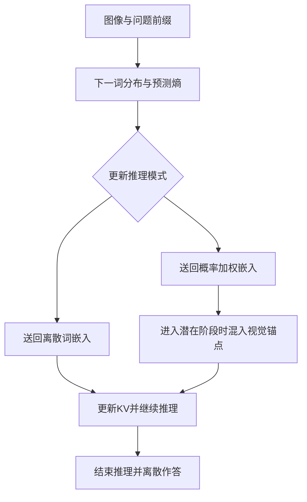

# Thinking in Uncertainty（LEAD）

CVPR 2026 主会Entropy-aware decodingTraining-freeautomated

[CVF论文](https://openaccess.thecvf.com/content/CVPR2026/html/Xu_Thinking_in_Uncertainty_Mitigating_Hallucinations_in_MLRMs_with_Latent_Entropy-Aware_CVPR_2026_paper.html){ .kb-button .primary } [独立补充](https://openaccess.thecvf.com/content/CVPR2026/supplemental/Xu_Thinking_in_Uncertainty_CVPR_2026_supplemental.pdf){ .kb-button } [arXiv v1](https://arxiv.org/abs/2603.13366v1){ .kb-button } [官方代码](https://github.com/mlrm-LEAD/mlrm-LEAD){ .kb-button }

<strong>一句话总结</strong>
LEAD在视觉推理的高熵阶段将候选词的加权嵌入送回模型，进入该阶段时加入视觉特殊词先验；五个7B推理模型在作者报告的POPE设置上得到正向结果。静态锚点能否增加当前图像的实质贡献，以及收益有多少来自切换、融合或提前结束推理，仍需匹配对照。

## 官方方法概览图

<figure class="paper-figure"><figcaption>CVF正文Figure 4展示熵门控、视觉锚点和下一步输入嵌入。原图独立再分发许可待核对；下图为<strong>本站等价抽象</strong>。</figcaption></figure>

## 1. 论文速览

| 维度 | 内容 |
|---|---|
| 研究对象 | 带显式推理阶段的视觉语言模型，覆盖存在性问答与开放回答的图像不一致 |
| 核心假设 | 在部分高熵推理步骤，离散采样过早消除候选分布信息；视觉先验可能帮助模型重新利用图像上下文 |
| 干预位置 | 当前分布决定下一次解码传入的输入嵌入；单序列、单解码轨迹复用 KV |
| 外部依赖 | 推理中无需外部检测器或模型；论文文本质量评价使用GPT-5和GPT-2 |
| 主要评测 | MMHalu、Bingo、POPE、RealWorldQA、MathVision、MathVista等 |
| 最适合角色 | 推理阶段的选择性干预对比、置信触发与状态表达的研究背景 |

## 2. 研究背景与核心矛盾

### 2.1 幻觉单位与观测边界

正文Figure 1按200样本的图示统计连接词10-token窗口与幻觉共现，Figure 2展示连接词附近的高熵现象。评测则在最终答案层读出开放回答评分或存在性准确率。开放评分、POPE准确率、推理轨迹逐条事实正确率分别对应不同单位。连接词出现频率、实际覆盖的token比例、位置与答案长度都可能抬高共现数。需要匹配位置、跨度与句法，再比较条件错误率。

### 2.2 既有方法与缺口

VCD通过真实图像与扰动图像的双前向修改候选 logits。MemVR在高不确定性时回注来自当前图像的视觉表示，SID对比弱化特定视觉 token 所得的分布。LEAD直接改变下一步的输入表示，保留同一条缓存轨迹，因而把可研究问题落在“触发发生在哪里”和“触发后将什么送回模型”。

### 2.3 核心假设与证据强度

| 假设 | 原文证据 | 证据类型 | 替代解释 |
|---|---|---|---|
| 高熵步骤更可能是推理敏感点 | Figures 1–3连接词观察、按熵和位置遮掩 | 共现与扰动 | 词性和位置；遮掩破坏文本连贯性；更早扰动拥有更长传播窗口 |
| 潜在嵌入能改善不确定阶段的推理 | Figure 5比较动态/固定阈值，Figure 6扫描离散窗口 | 模式策略消融 | 切换率、词向量范数、续写样式与终止预算也可能变化 |
| 视觉锚点有额外收益 | Table 1扫强度，Figure 7显示特定案例attention再分配 | 组件干预与定性图 | 同范数非视觉先验、词嵌入扰动和平滑效应；视觉attention只是路由证据 |

## 3. 方法详解

### 3.1 输入—状态—输出

模型以图像及问题完成 prefill。对第 $t$ 步模型分布计算预测熵，结合当前模式、参考熵和离散驻留长度决定送回离散词向量或连续混合向量。参考熵在发生模式切换时更新。每次进入潜在阶段的首步加入锚点。论文设定达到切换预算后结束思考，最终答案使用离散解码。

### 3.2 关键量与维度

记词表大小 $V$，输入嵌入矩阵 $E\in\mathbb R^{V\times d}$，输入嵌入维度 $d$。第 $t$ 步最后一个位置的 logits $z_t\in\mathbb R^V$ 经 softmax 得 $p_t$。正文Eq.3–5可写成以下等价记号。

\[
H_t=-\sum_{v=1}^{V}p_t(v)\log p_t(v),\qquad e_{mix,t}=p_t^\top E\in\mathbb R^d.
\]

低熵状态送回采样词 $r_t$ 的一行 $E_{r_t,:}$，进入潜在状态后送回 $e_{mix,t}$。按正文Eq.6–8，离散转潜在同时要求 $H_t>\widehat H$ 且离散驻留计数不小于窗口 $W_{D\to L}$，潜在转离散可在 $H_t<\widehat H$ 时立即发生。正文默认切换上限 $C_{max}=5$；Figure 6的两个模型和两项评分在被比较窗口中支持128步附近的选择。

正文Eq.9在潜在阶段首步 $t^*$ 写为

\[
\widetilde e_{t^*}=(1-\lambda)e_{mix,t^*}+\lambda e_{vis},\qquad \lambda\in[0,1].
\]

其中 $e_{vis}$ 是词表内视觉起始、图像占位和视觉结束特殊词的预训练输入嵌入均值。它对同一骨干模型为固定先验。当前图像经 prefill 注入上下文，锚点处没有再次编码其像素。混合后的单个向量由同一缓存轨迹消费，后续 Transformer 是非线性的，$f(\mathbb E[e])$ 一般无法视为 $\mathbb E[f(e)]$；独立候选推理分支的状态没有被逐个保存。

### 3.3 CVF公式与发布实现

下列差异来自对官方仓库固定 commit 的静态阅读；当前发布实现与主表运行配置之间的映射仍待作者核对。

| 部件 | CVF正文 | 发布实现 |
|---|---|---|
| 熵与采样 | Eq.3–5用预测分布表达；§4.1用greedy示例说明离散输出 | 熵和全词表混合用未温度处理的softmax；记录的离散ID来自温度与top-k/top-p处理后的分布。CLI默认采样、temperature 0.6、top-k 20、top-p 0.95、seed 42 |
| 模式切换 | Eq.6–8给动态参考熵与最短离散窗口 | 从soft模式开始，额外加入绝对熵阈值1.0和0.2；代码默认窗口256，并针对数学符号与标记词表中的ID强制使用离散输入 |
| 锚点 | Eq.9用三个视觉特殊词平均，扫描固定 $\lambda$ | 首步混入换行嵌入；后续转soft时用单个image-pad嵌入，混合权重随生成预算推进；转normal还可能混入结束思考词 |
| 停止 | §3.2描述总切换数触发结束推理 | 只累计soft→normal；达阈值后入队收敛/终止文本，路径取决于实际输出 |
| 日志 | 论文展示可读推理样例 | 代码在soft步仍记录离散ID、实际送回混合嵌入；日志可用于表面质量评价，检验模型实际读取的状态时需要额外记录分布、模式与嵌入 |

正文 Algorithm 1还写了L2归一化，发布的词表矩阵乘直接使用softmax概率。复现应将“CVF公式复刻”和“固定发布代码运行”分别登记，使用每行精确配置解释差异。

### 3.4 成本与可能的替代解释

官方实现将视觉输入交给 prefill，之后每步传 `inputs_embeds` 和 `past_key_values`，避免VCD式第二分支。全词表向量乘代价随 $Vd$ 增长，代码每步构造候选混合嵌入，离散步也经过这一计算；省生成步数与省墙钟时间需要分别计量。提前结束思考、软嵌入造成的变化和匹配图像证据的增加都可能解释最终分数，需指定预算或做成组消融。

## 4. 实验设计与关键结果

### 4.1 设置

| 项目 | CVF设置及复现缺口 |
|---|---|
| 主表模型 | R1-Onevision-7B、Vision-R1-7B、VL-Rethinker-7B、VL-Cogito-7B、OpenVLThinker-7B |
| 任务 | 通用VQA与感知、MMHalu/Bingo/POPE、数学及MMK12；主结果表没有逐样本 split 清单 |
| 对照 | 原骨干、VCD、MemVR、SID。正文Table 2的三种额外解码对照集中在R1-Onevision-7B |
| 解码预算 | 独立补充B写VCD采用top-p采样、MemVR和SID采用greedy，精确同预算/同采样设置待复算 |
| 外部评估 | 正文Figure 8以GPT-5评语法、自然度与流畅性，GPT-2给PPL；评估器精确版本与prompt未定位 |
| 统计 | 主要结果为点估计，未找到配对CI、多seed方差或显著性检验 |

独立补充Table 1/2覆盖额外骨干和规模。§A2文字列InternVL3.5-14B，补充两张表写InternVL3.5-8B-Think；该行型号待作者确认，下文定量结论只使用CVF正文的五个7B骨干及相应实验。

### 4.2 主结果

| 模型、任务、指标↑ | Base | LEAD | 净变化 | 近邻对照 / 原文位置 |
|---|---:|---:|---:|---|
| R1-Onevision，MMHalu评分 | 3.52 | 3.80 | +0.28分 | MemVR 3.69，SID 3.70；正文Table 2 |
| R1-Onevision，Bingo评分 | 3.65 | 3.84 | +0.19分 | MemVR 3.68；正文Table 2 |
| R1-Onevision，POPE adversarial Acc | 82.5% | 83.9% | +1.4 pp | MemVR 83.5%，SID 81.9%；正文Table 2 |
| Vision-R1，POPE adversarial Acc | 84.0% | 87.7% | +3.7 pp | 对照为同骨干Base；正文Table 2 |
| OpenVLThinker，POPE adversarial Acc | 79.1% | 80.2% | +1.1 pp | 对照为同骨干Base；正文Table 2 |
| R1-Onevision，MathVision Acc | 29.9% | 32.4% | +2.5 pp | 对照为同骨干Base；正文Table 3 |

MMHalu和Bingo报告各自评分尺度。这里使用原始分差，避免将表中括号百分数解释为幻觉发生率的变化。POPE表无按类别汇总，不能由准确率计算 FP/FN 或对象Recall。

### 4.3 消融与分析实验

| 实验 | 证据与对照 | 可用结论 | 尚缺对照 |
|---|---|---|---|
| 锚点强度 | 正文Table 1，R1-Onevision从 $\lambda=0$ 到0.4，MMHalu 3.59→3.80、Bingo 3.74→3.84；0.6分别回退到3.77/3.76 | 这个协议下适度注入改善两个评分 | 同范数随机或文本锚点、交换图片、跨数据冻结参数 |
| 切换阈值 | 正文Figure 5比较多个固定阈值、全离散与动态阈值 | 动态策略在报告任务上占优 | 匹配切换频率及潜在步数，避免把时长差归给触发信息 |
| 驻留窗口 | 正文Figure 6比较64、128、256与无限窗口 | 选择中间窗口在所示协议有收益 | 测试前独立决定窗口，按问题长度分层 |
| 轨迹与文本质量 | 正文Figures 8–9给评估器分数和MathVision平均推理长度与准确率 | 提供文本质量与步数审计的起点 | 每步/总时延、KV显存、同预算与逐条对象覆盖 |
| 多次采样 | 正文Figure 10和独立补充C，R1-Onevision在RealWorldQA/MathVista比较Pass@k | 可用作采样效率对比 | 固定总生成token和墙钟，逐样本计算配对CI |

### 4.4 证据适用范围

正文主表支持五个推理骨干在已报告的POPE三个子集中提高准确率，开放回答分数也有改善。机制上，系数消融支持视觉特殊词嵌入的增益，但仍需控制其范数、词义、切换时点和推理长度才能归因到当前图像视觉证据。没有独立证据支持 caption 对象召回或相同预算下的低时延外推。

## 5. 亮点与贡献

LEAD把一个解码决策拆为不确定性触发、候选分布的输入读出和一次性视觉初始化。其改动位于输入嵌入而非候选logit重排，也不同于head放大或外部证据检索，适合作为输入表示干预的参照。Table 1的零锚点行可作为分离组件效应的起点；逐步记录分布、实送嵌入与生成ID会进一步提高可诊断性。

## 6. 局限、指标漏洞与审稿风险

1. **Proxy validity**。高输出熵同时反映识别歧义、句法自由度与采样前候选竞争。以词性、位置、初始长度、答案类型分层，比较阈值触发的误报、漏报及覆盖率。
2. **静态先验及语言混淆**。改变锚点可能改变样式或停止偏好。匹配前缀下对照真实、空白、换图和与样例无关的同范数控制，观察目标词方向及正确率的图像条件交互。
3. **标注和评价**。开放任务主评分、GPT辅评文字质量、POPE准确率各有独立误差来源。需要对不明确标注、拒答与偏"No"分层；外部评价器变更时单独重算。
4. **长度与覆盖**。若更早结束思考即可得到类似结果，应将停止策略记入收益。caption外推需要同时报告对象Recall、覆盖率、重复与长度，检查是否因少提对象降低表面错误。
5. **错误积累和跨骨干外推**。早步遮掩的更强影响可受剩余轨迹长度解释。补充骨干型号矛盾与发布实现差异限制了逐配置复现，静态代码审计没有确认论文实际运行版本。
6. **调参与代价**。独立dev/test选参记录、同采样预算、批量墙钟与显存峰值仍待补。报告通过阈值的频率与未激活时的维持开销。

## 7. 与我的研究关系

### 7.1 领域层面比较

[MemVR](memvr.md)与LEAD均用不确定性选择干预时刻；MemVR回注由当前图像得到的视觉隐状态，LEAD的锚点来自模型词表。与[VES-RFT](ves-rft.md)和[VISOR](visor.md)比较时，可记录 real/null/edited 条件下同一前缀的目标词 logit 差分，把视觉输入变化与LEAD的熵触发分开测量。[Reallocating Attention](reallocating-attention.md)以头输出增益作用于长推理，适合在同骨干、同预算比较干预点。对使用POT、VR、PD或RBC的研究，应先冻结指标定义，再检验在同位置同前缀下能否解释 $H_t$ 之外的风险和干预异质性。

### 7.2 Baseline决策

**Medium（带思考阶段的VLM推理）/ Low（作为现成caption或机制识别基线）。** 模型权重无需改动且有公开入口，便于小规模对照；论文公式、算法和公开实现的差异需分别重跑。公开方法适用性可比较，个人未公开研究适配 **UNKNOWN**。

### 7.3 面向CVPR的可借鉴证据

| 层级 | 可借鉴内容 |
|---|---|
| 官方投稿信息 | 以[CVPR 2027 CFP](https://cvpr.thecvf.com/Conferences/2027/CallForPapers)公布的规则为准 |
| 本文实证 | 分别给开放回答与存在性评测，比较同骨干base与三类解码方法，给锚点与切换消融 |
| 本站建议 | 明确触发选择和作用路径，分解多组件贡献，使用同位置、同预算、同范数控制并记录失败样例、配对CI和语义覆盖 |

## 8. 可执行的后续实验

以下为领域公开实验建议，成本为计划范围，本轮未运行模型。

| 实验 | 问题、模型与数据 | 干预与记录 | 预期与失败判定 | 成本 |
|---|---|---|---|---|
| E1 同前缀视觉因子 | R1-Onevision-7B，50–100条POPE；锚点是否放大对图像变化的响应 | 相同问题与前缀配对真实、空白、换图；固定触发位置，比较无锚、官方锚、同范数文本锚；记录目标YES/NO logit、$H_t$ | 如果增益在换图或非视觉锚同样出现，当前图像证据归因不成立 | Low，抽样执行约1–3 GPU小时 |
| E2 排除位置混淆 | 同一骨干，100条有标注推理轨迹；高熵能否独立预测未来错误 | 在词性和步数分层后，比较高熵与同位置低熵；固定10-token窗口、报告负例、基率、AUROC/AUPRC | 如果分层后指标接近位置基线，降低熵作为特异检测信号的权重 | Low，缓存 logits 后CPU分析 |
| E3 分解软模式与停止 | 100条POPE/MathVision；哪个组件贡献主要效应 | no-op、latent-only、latent+anchor、等预算离散截断；冻结逐步上限和答案预算；记录准确率、长度、拒答、延迟、峰值显存 | 离散截断达到同等收益时，单独报告终止策略解释 | Medium，约2–6 GPU小时 |
| E4 文本质量与图像覆盖 | 100张COCO图，兼有思考/短答案协议；抑制错误是否损失对象覆盖 | 比较原模型、发布LEAD与长度匹配离散生成；报告CHAIRs/i、对象Recall、长度、重复、FP/FN；按图做bootstrap | CHAIR改善但Recall显著回退时，不能支持保召回结论 | Medium，约2–6 GPU小时 |

## 9. 复现清单

- [x] 核对CVF正文、独立补充、arXiv版本和官方代码入口。
- [x] 记录发布代码commit、默认采样和缓存输入路径，登记与公式及补充元数据的差异。
- [x] 主表与锚点消融保留数字、对照、单位和原文位置。
- [ ] 获取主表逐模型实际代码版本、split、prompt及采样配置，核对InternVL补充型号。
- [ ] 固定评测器的版本与prompt，用配对CI复算性能并审计类别偏置和对象覆盖。
- [ ] 在同设备、同推理预算和同生成配置下测首token时间、总时延与峰值显存。

## 10. 综合评分

| 维度 | 评分 1–5 | 理由 |
|---|---:|---|
| 直接相关性 | 4 | 推理期基于预测分布的选择性干预，涉及视觉依赖与错误传播 |
| 新颖性 | 4 | 将软输入表示、熵状态切换和视觉特殊词先验组合应用于多模态解码 |
| 机制证据 | 2 | 有遮掩及组件扫参，缺少匹配位置和图像条件的必要对照 |
| 实验完整性 | 3 | 多骨干和多评测，主表配置与统计不全 |
| 可复现性/低算力 | 3 | 有发布代码与单轨迹实现，主表配置映射仍待独立验证 |
| 知识库新增信息 | 5 | 与head增益、对比logit和图像表示回注形成可比较的输入嵌入干预 |

## 11. 检索标签与来源边界

- [CVF论文页](https://openaccess.thecvf.com/content/CVPR2026/html/Xu_Thinking_in_Uncertainty_Mitigating_Hallucinations_in_MLRMs_with_Latent_Entropy-Aware_CVPR_2026_paper.html)确认完整作者、CVPR 2026主会及11064–11075页；关键数值以[CVF正文PDF](https://openaccess.thecvf.com/content/CVPR2026/papers/Xu_Thinking_in_Uncertainty_Mitigating_Hallucinations_in_MLRMs_with_Latent_Entropy-Aware_CVPR_2026_paper.pdf)和[独立补充](https://openaccess.thecvf.com/content/CVPR2026/supplemental/Xu_Thinking_in_Uncertainty_CVPR_2026_supplemental.pdf)为准。
- [arXiv:2603.13366v1](https://arxiv.org/abs/2603.13366v1)于2026-03-09提交，DOI 10.48550/arXiv.2603.13366对应预印本。论文页另有[作者项目页](https://mlrm-lead.github.io/)。代码与项目页均为作者材料。
- 2026-11-19固定[官方代码commit](https://github.com/mlrm-LEAD/mlrm-LEAD/tree/dd2651d2ce04abba0e77af803fad42177a51d7b1)，对照了[`generation_utils.py`](https://github.com/mlrm-LEAD/mlrm-LEAD/blob/dd2651d2ce04abba0e77af803fad42177a51d7b1/lead/generation_utils.py)、[`inference.py`](https://github.com/mlrm-LEAD/mlrm-LEAD/blob/dd2651d2ce04abba0e77af803fad42177a51d7b1/lead/inference.py)及[入口配置](https://github.com/mlrm-LEAD/mlrm-LEAD/blob/dd2651d2ce04abba0e77af803fad42177a51d7b1/main.py)。没有执行作者代码，亦未验证主表可按该快照逐项复现。
- 公开索引提供[OpenReview入口](https://openreview.net/forum?id=LjMwwoOnpJ)。入口当日触发浏览器验证，公开API返回403；评审文本、rebuttal及decision均未取得可引用证据。正式收录状态由CVF确认。
- 正文Figure 4已定位，原图独立再分发许可待核对，本页使用本站等价抽象。方法主张与表值来自论文，配置对照来自官方代码，替代解释、局限分级和实验设计为本站分析。
