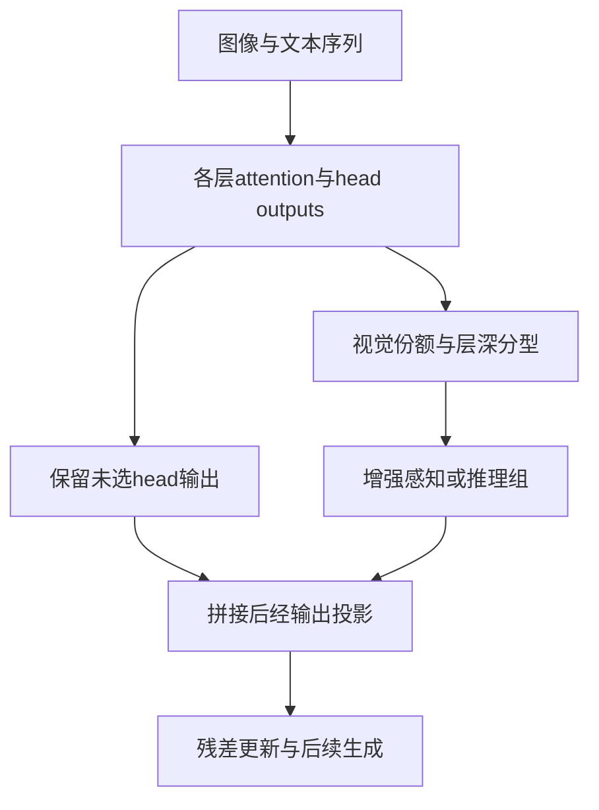

# Reallocating Attention Across Layers

CVPR 2026 主会Head output rescalingTraining-freeautomated

[CVF原文](https://openaccess.thecvf.com/content/CVPR2026/html/Lu_Reallocating_Attention_Across_Layers_to_Reduce_Multimodal_Hallucination_CVPR_2026_paper.html){ .kb-button .primary } [独立补充](https://openaccess.thecvf.com/content/CVPR2026/supplemental/Lu_Reallocating_Attention_Across_CVPR_2026_supplemental.pdf){ .kb-button } [arXiv v3](https://arxiv.org/abs/2510.10285v3){ .kb-button }

<strong>一句话总结</strong>
用层深与visual attention ratio给heads分型，只放大被选head的输出，不压低其余head。三种推理模型的任务分数提高，但“视觉份额＝感知功能”“只增强必有收益”并未得到无条件证明，补充材料的投影后reshape也不能直接当作真正的head归因。

## 官方方法概览图

<figure class="paper-figure"><figcaption>作者在CVF正文Figure 2给出分型、增益和MHA输出流程。原图独立再分发许可未确认，故不复制；下面是<strong>本站等价抽象</strong>，不是官方原图。</figcaption></figure>

## 1. 论文速览

| 维度 | 内容 |
|---|---|
| 对象与设定 | 长推理VLM的视觉判断、数学与多选任务；不是caption对象词检测器 |
| 核心假设 | 视觉优先浅层与文本优先深层存在功能分工，相关head贡献不足会导致错误 |
| 干预 | 推理期head output乘常数，位置在输出投影前；不更新骨干参数 |
| 外部依赖 | 在线不需detector/CLIP；比较方法CGD需要CLIP，评测需要答案标注 |
| 主要评测 | MathVista-mini、MathVision-mini、HallusionBench、MMStar、SEED-Bench |
| 最适合角色 | 长推理head-rescaling comparison / related work；理论与实现审计案例 |

## 2. 研究背景与核心矛盾

### 2.1 研究的 hallucination

论文将错误分为感知偏差和推理漂移，但主表实际读出是最终答案Accuracy与F1；数学题答错不自动等价于视觉幻觉。HallusionBench更接近视觉—语言冲突诊断，其他任务主要提供能力覆盖。正文提及CHAIR、POPE作为背景，并不等于本文在这些caption/存在性协议上完成验证。不能把主表的F1当作对象Recall，也不能宣称它已经解决长caption中的对象、属性和关系幻觉。

### 2.2 缺口与替代解释

本方法不需要对比解码的额外图像分支，试图以低成本同时提升视觉和推理任务。真正需要检验的是：收益是否来自功能识别，还是来自任意稀疏放大、层深先验、输出幅度或模板偏好。visual attention ratio是可观测的routing份额，head是否写入正确语义还取决于V、输出投影和下游残差。层深命名不能取代独立的功能验证。

### 2.3 核心假设与证据强度

| 假设 | 公开证据 | 类型 | 仍不能排除 |
|---|---|---|---|
| 两类heads应联合增强 | 正文Table 2单组/双组消融 | 组件干预 | 等数量随机head、同norm放大、输出偏置 |
| 层边界反映分工 | 正文Figure 4边界扫描 | 超参数关联 | 同一评测集选参；性能最优边界不是功能边界真值 |
| 模态份额能识别功能 | Eq.7–9与案例贡献图 | proxy + 定性归因 | 位置/序列长度、文本内视觉记忆、归因hook位置 |
| 增强比抑制更安全 | Supplement B差分恒等式与期望推导 | 条件线性分析 | 被增强组贡献的符号、非线性和跨层反馈 |

## 3. 方法详解

### 3.1 输入—中间量—干预—输出

给定图像token集合 $T_v$、文本token集合 $T_t$ 和query集合 $T_q$，标准attention先产生 $A^{(h,\ell)}$ 与 $O^{(h,\ell)}=A^{(h,\ell)}V^{(h,\ell)}$。按visual mass与层范围给head分型，给感知/推理组分别乘 $g_{perc},g_{reas}$，未选head保持1，再拼接并经过 $W_O$。这修改当前层的value加权输出，而不是直接把当前层attention矩阵重新归一化；后续层attention当然可能随残差改变。

### 3.2 公式、维度和位置

令 $N_q,N_k$ 为query/key长度，$H$ 为头数，$d_h$ 为每头宽度，$d=Hd_h$。$A\in\mathbb R^{H\times N_q\times N_k}$，$O_h\in\mathbb R^{N_q\times d_h}$，$W_O\in\mathbb R^{d\times d}$；batch维省略。

正文Eq.7写的是单个query $i^*$ 的份额：

\[
S_v^{(\ell)}(h;i^*)=\sum_{j\in T_v}A^{(h,\ell)}_{i^*j}.
\]

紧随其后的文字却称“对全部query平均”。若采用平均，应明确另定义 $\bar S_v=|T_q|^{-1}\sum_{i\in T_q}S_v(h;i)$；这是**本站补足记号**，不是已核实的发布代码。prefill全query和KV解码最新query不等价，不能静默互换。Eq.8用以下条件筛选：

\[
\mathcal H_{perc}^{(\ell)}=\{h:\ell\le\ell_{perc},S_v\ge\tau_{perc}\},\quad
\mathcal H_{reas}^{(\ell)}=\{h:\ell\ge\ell_{reas},S_v\le\tau_{reas}\}.
\]

当 $\tau_{reas}<\tau_{perc}$ 时，同一head不会同时属于两组，即使两个层范围重叠。正文Eq.10为：

\[
Y'^{(\ell)}=\operatorname{Concat}_h\big[g^{(h,\ell)}O^{(h,\ell)}\big]W_O^{(\ell)},
\quad g\in\{g_{perc},g_{reas},1\}.
\]

该式已包含干预量；实际实现不应再把同一 $\Delta Y=Y'-Y$ 加一次。正文随后用 $Y'+\Delta z$ 描述概念更新，复现时需防止重复计入。

### 3.3 实现与成本

Supplement D说明修改 `modeling_qwen2_5_vl.py` / `modeling_kimi_vl.py` 的 `eager_attention_forward`，缓存视觉位置与超参数。无需在线梯度训练；Supplement H的梯度只服务贡献图分析，不应算作每步部署操作。常规KV缓存仍可使用，但公开文字未明确分型是在prefill、逐步还是全query重算。

| 模型 | $\ell_{reas},\tau_{reas},g_{reas}$ | $\ell_{perc},\tau_{perc},g_{perc}$ | 来源 |
|---|---|---|---|
| Kimi-VL-A3B-Thinking | 5, 0.01, 1.40 | 10, 0.27, 1.20 | CVF Supplement Table 3 |
| Ocean-R1-7B-Instruct | 3, 0.01, 1.30 | 7, 0.22, 1.16 | 同上 |
| R1-Onevision | 3, 0.01, 1.30 | 7, 0.30, 1.20 | 同上 |

Supplement C只证明在固定hidden宽度的全序列eager设定下仍是 $O(N^2)$，不能由此推出零墙钟/显存成本。materialize全attention可能失去FlashAttention的优势；cached decoding的query长度与prefill不同，须另测。未找到可冻结的官方实现commit，不伪造代码URL。

### 3.4 理论审计：恒等式不等于正确率保证

CVF独立补充B的Eq.6–7表明，在同一线性输出层、相同增强组和相同增益下，额外抑制另一组产生 $(\beta-1)O_{att}$。这是可直接相减得到的代数恒等式，不证明任务结果。

随后令 $u_h=\langle O_h,v\rangle$，$U(S)=\sum_{h\in S}u_h$，其中 $v$ 是假定的task-aligned方向；忽略LayerNorm后 $\Delta_A\approx(\alpha-1)U(H_{enh})$。Eq.14只假设 $\mathbb E U(H_{att})\ge0$，可导出抑制项的期望非正，却**单独不能导出Eq.15的 $\mathbb E\Delta_A>0$**；还需要 $\mathbb E U(H_{enh})>0$。若把“已验证有益”作为额外前提，则正收益是条件结论，ratio筛选本身没有证明此条件。

本站反例：单个被增强head有 $u=-1$，其余待抑制组 $U=0$，$\alpha=1.2$；非有害假设满足，但 $\Delta_A=-0.2$。这只否定无条件推论，不否定主表经验收益，也不构成实模型实验。即使局部投影增大，后续非线性、采样与目标不一致仍阻止把它升级为全模型正确率定理。

## 4. 实验设计与关键结果

### 4.1 设置

| 项目 | 公开设置与缺口 |
|---|---|
| Models | Kimi-VL-A3B-Thinking、Ocean-R1-7B-Instruct、R1-Onevision-7B |
| Tasks | 两个数学mini集、HallusionBench、MMStar、SEED-Bench；具体使用样本ID未提供 |
| Metrics | Accuracy；Supplement G定义按support加权F1，不能与caption对象recall混同 |
| Baselines | Vanilla、VCD、CGD、AGLA；不是全部head-editing近邻的穷尽比较 |
| Ablations | 两组分别关闭、层边界、增益、份额阈值和干预head数量 |
| Statistics | 表格有±；未定位其重复次数、seed和SD/SE/CI定义，不能按95%CI引用 |
| Prompt / generation | 未找到足够完整的模板、答案抽取、最大token数与采样配置，需冻结后独立复现 |
| Hardware | Ocean-R1用A40；另外两者用A800，CPU配置不同；效率不能跨设备直接归因方法 |

### 4.2 主结果

以下是**CVF正文Table 1**的逐格读数，均为百分数、越高越好，变化为本站计算的百分点；不跨不同任务作统一排名。±的含义未澄清，保留原文数值而不作显著性解读。

| 模型 / 数据 / 指标↑ | Vanilla | 本文 | 变化 | 直接比较 / 来源 |
|---|---:|---:|---:|---|
| Kimi，MathVista-mini Acc | 63.48±0.91 | 69.78±0.82 | +6.30 pp | AGLA 67.32±1.11；Table 1 |
| Kimi，HallusionBench Acc | 64.76±0.52 | 68.19±1.07 | +3.43 pp | VCD 65.68±0.62；Table 1 |
| Ocean-R1，HallusionBench Acc | 49.41±0.61 | 53.64±1.58 | +4.23 pp | VCD 50.57±0.52；Table 1 |
| Ocean-R1，MMStar Acc | 45.24±0.41 | 50.77±1.14 | +5.53 pp | AGLA 48.48±0.53；Table 1 |
| R1-Onevision，MathVista-mini Acc | 59.92±1.13 | 60.09±1.48 | +0.17 pp | AGLA 60.21±1.48更高；Table 1 |

主表支持“在这些模型和协议上有任务收益”，不支持所有格子优于所有baseline。Ocean-R1的MathVision-mini Full在正文Table 1为26.01±0.50，Table 2为25.68±0.50；此冲突值不纳入以上主证据，也不据此重新算总体平均。Kimi SEED F1也有Table 1/2的53.62/53.64差异。数字可逐表溯源，但不应自行挑一个作为统一结果。

### 4.3 消融与分析实验

| 实验 | 唯一变化与读数 | 能支持 | 不能证明 | 原文位置 |
|---|---|---|---|---|
| 双组vs单组 | R1-Onevision MathVision Acc：Vanilla33.54；仅感知33.90；仅推理29.63；Full39.12 | 联合效应非加性 | 感知/推理命名是唯一正确解释 | 正文Table 2 |
| 存在回退 | Ocean-R1 HallusionBench：仅推理54.37，Full53.64；Kimi MathVision仅推理62.84，Full60.54 | Full不在每个任务最优 | 同时增强总是更安全 | 正文Table 2 |
| 层范围 | 改两组边界，其余增益/阈值固定；最优区域随任务变 | 层选择影响性能 | 普适清晰分界、held-out调参无泄漏 | 正文Figure 4；不从曲线猜数 |
| 增益/阈值 | Figure 5分别扫增益和visual ratio阈值，数量随阈值变化 | 稀疏性和强度有影响 | 比同层同数随机组更优 | 正文Figure 5 |
| 时延 | HallusionBench每batch 101→103秒；MathVista98→103秒 | 所报告设置中约+2.0%与+5.1% | 相对FlashAttention同等开销、普适<1%时延 | CVF Supplement Table 2 |
| 案例归因 | 使用gate梯度绝对值画贡献图；H.2–H.5给正向案例 | 特定样本的敏感性可视化 | 真实head归因、失败率或随机化因果证据 | Supplement H |

注意Supplement H.1 Eq.34先说输出已经经过 $W_O$，Eq.35再reshape成heads。一般稠密 $W_O$ 混合头维度，因此**投影后的坐标块不等价于投影前attention heads**。除非实际hook位于投影前或显式按 $W_O$ 子块分解，该贡献图的“head”解释不成立。此为本站实现审计，未找到代码以确定作者实际hook，不能武断声称已证实实现bug。正文方法Eq.10的投影前缩放与该归因描述必须分开。

### 4.4 支持与不支持

- 支持：选定模型/任务上增强两组head有可观察收益；不同组的效应存在交互；低额外分支成本值得比较。
- 不支持：纯视觉因果机制已识别、只增强绝不会损伤、caption Recall被保留、跨模板零校准、相对现代优化attention实现始终低开销。

## 5. 亮点与贡献

最大价值是把“多看图”拆成视觉份额、层范围、输出贡献三个可比较选择，并提供单组/双组消融；它提醒读者文本通路也可能携带正确视觉摘要。与此同时，标题中的reallocation不意味着对attention概率做守恒搬移，核心实现是head output gain。理论审计使这篇工作适合用来训练“定义—假设—可观测证据”的分离，而不是照搬其功能命名。

## 6. 局限、指标漏洞与审稿风险

1. **Proxy validity**：mass不读取值向量语义；query数、图像token数、位置与重复会改变份额，需匹配或分层。
2. **评测单位**：最终答案准确率提高，不证明reasoning trace逐条更真实；二元yes偏置、多选解析和答案长度都可能影响结果。
3. **选参**：150余边界组合与增益扫描意味着“无需训练”不等于“无需标签选参”；独立dev/test协议未知，只能列为风险，不能断言发生泄漏。
4. **质量与覆盖**：未给对象Recall、caption coverage、长度、重复以及错误类型配对统计，不能宣传recall-preserving。
5. **统计**：未定义±、重复次数与配对检验；0.17pp这类小增益不宜放大。
6. **实现/理论**：query平均、输出投影后归因与额外增量记号存在解释缺口；复杂度阶相同不代表成本相同。
7. **外部评价**：未找到可引用的独立权威技术评议或公开review/rebuttal；以上疑问均为本站分析，不冒充reviewer concern。

## 7. 与我的研究关系

### 7.1 领域层面联系

本文不是real-vs-null/counterfactual对比方法；与[VISOR](visor.md)的visual increment、[SADT](same-attention-different-truths.md)的语义读出和[Role-Break](role-break-attention-heads.md)的结构异常是互补观察量。与[AdaIAT](adaiat.md)共享“文本通路可承载视觉证据”的问题，但前者缩放head输出，后者改generated-text attention，不是等价操作。这里是本站按共同问题组织的关系，不声称作者互引。

POT这类外部图文匹配与本文内部mass处在不同测量层；VR/PD/RBC也需先给出各自定义，再做条件相关/增量预测，不能把同一份额的代数重写当作新证据。个人未公开实验、方法和投稿适配一律 **UNKNOWN**。

### 7.2 Baseline决策

**Medium（长推理比较）/ Low（现成可复现caption基线）。** 不需骨干微调、单分支是优势；代码、query轴和选参协议缺失提高复现成本。先实现中性gain=1与同数同层随机组，只有在公平预算下有效才扩到更大模型；不能把重新实现默认为官方复现。

### 7.3 面向CVPR的可借鉴证据

| 层级 | 应如何使用 |
|---|---|
| 官方规则 | [2027 CFP](https://cvpr.thecvf.com/Conferences/2027/CallForPapers)要求原创研究；独立2027审稿细则本轮未确认，不沿用往届当作新规 |
| 本文实际证据 | 三模型、五任务、组件消融和时延表；不含完整caption保召回审计 |
| 本站建议 | 最近邻head-scaling对比、同数随机头、投影前hook单测、独立选参、配对CI、FP/FN与质量报告 |

这些建议服务证据完整性，不是录用条件或保证。

## 8. 可执行的后续实验

以下均为公开方法层面的复现建议，本轮未执行。成本是计划估计，不是论文实测；先在单张可容纳7B的GPU上做小样本，再决定是否扩展。

| 实验 | 问题 / Model-data | 干预与记录 | 判定 / 失败条件 | 成本估计 |
|---|---|---|---|---|
| E1 hook单测 | 真head与输出坐标块是否一致；任意7B，8条输入 | 投影前gain vs 投影后reshape；记录 $\Delta Y$、identity误差 | gain=1不恒等或两种实现被混同即停 | Low；CPU代数测试+少量forward，约<1 GPU小时 |
| E2 选择器对照 | 分型是否超出任意稀疏增益；100条HallusionBench | Full、同层同数随机、全head同norm；Acc、yes ratio、长度 | matched随机同样有效则不宣称功能识别 | Low/Medium；约1–4 GPU小时，依输出长度变化 |
| E3 功能符号 | 高visual mass是否实际支持正确答案；50条FP/TN/TP/FN | 同prefix有限差分head gain；存mass、目标logit变化、value语义 | 高mass组不更正向则proxy解释失败 | Medium；按层抽样避免全栈穷举，约1–4 GPU小时 |
| E4 外推与代价 | 固定dev配置能否迁移；200条新图/新模板 | 不重选阈值；Acc、FP/FN、caption Recall/CHAIR、长度、重复、eager/优化实现延迟 | 收益只在调参集或仅靠偏No/少说即失败 | Medium；约2–8 GPU小时，先报告实际token预算 |

## 9. 复现清单

- [x] CVF正文11页、独立补充16页完整读取；arXiv v3元数据及方法交叉核对；Table 1与Supplement B/H关键处视觉复查
- [x] 主要结果、增益/边界、单组消融、时延和数值冲突分开登记
- [ ] 截至2026-10-17未定位官方实现仓库与commit
- [ ] 明确query轴、prefill/KV策略、head hook投影位置、视觉边界与0/1-based层号
- [ ] 冻结prompt、decode、样本ID、dev/test选参、±定义与seed
- [ ] 配对CI、随机head、Recall/coverage/length/repetition和通用能力复算

## 10. 综合评分

| 维度 | 1–5 | 理由 |
|---|---:|---|
| 直接相关性 | 4 | 补充长推理场景的head-output比较 |
| 新颖性 | 3 | 层深分型+温和增益，算子简单 |
| 机制证据 | 2 | 功能proxy、归因位置和理论条件仍有缺口 |
| 实验完整性 | 3 | 多模型任务与消融齐；配置、统计与质量审计不足 |
| 可复现性/低算力 | 2 | 不训练骨干但无可冻结代码；eager成本待测 |
| 知识库新增信息 | 4 | 引入投影前后head语义、条件理论与任务交互审计 |

## 11. 检索标签与来源边界

- 正式元数据来自[CVF paper page](https://openaccess.thecvf.com/content/CVPR2026/html/Lu_Reallocating_Attention_Across_Layers_to_Reduce_Multimodal_Hallucination_CVPR_2026_paper.html)及其BibTeX：CVPR 2026主会，pp.4157–4167。
- 正文数字以[CVF camera-ready PDF](https://openaccess.thecvf.com/content/CVPR2026/papers/Lu_Reallocating_Attention_Across_Layers_to_Reduce_Multimodal_Hallucination_CVPR_2026_paper.pdf)为准；独立Supplement的表/公式编号与合并版不同，本页明确使用独立补充编号。
- 最新arXiv为2510.10285v3（2026-03-07）；本轮核对其元数据和方法HTML。数值与补充编号以已读取的CVF正文/独立补充为准，不宣称已逐格对齐所有版本。CVF下载入口本轮返回403，正文和补充使用保留的公开PDF副本；已复查CVF水印、页码、标题及关键表格/公式。
- 截至2026-10-17未发现可引用公开评审/rebuttal/decision正文或可归属的官方代码；OpenReview作者检索结果可见CVPR元数据和另一条ICLR withdrawn题名记录，但动态页面未返回可核验评审。元数据公开不等于评审公开，旧投稿也不能未经核对当作同一版本的审稿证据。
- arXiv许可为perpetual non-exclusive；未确认独立再分发Figure 2许可，使用明确标注的本站抽象。
- 主表值、参数与方程为paper evidence；“恒等式不等于保证”、反例、hook语义审计、评分与建议为本站推断。没有独立运行模型、训练或复现实验。
