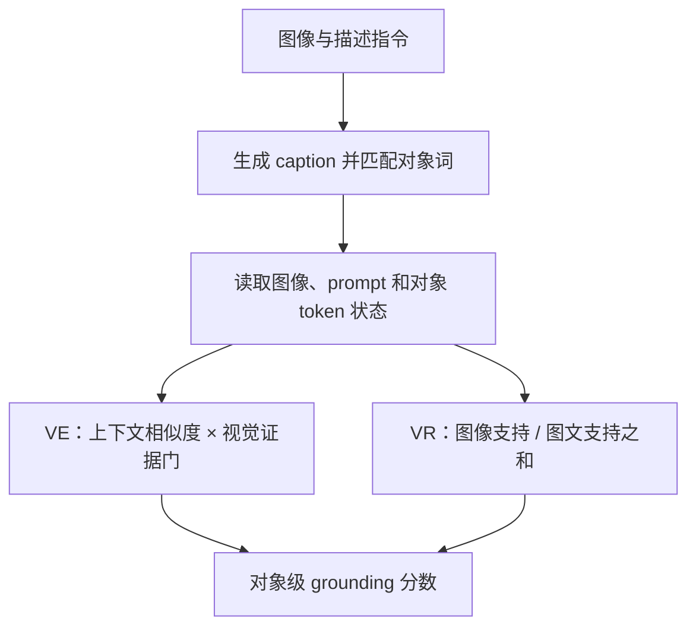

# VisER

EMNLP 2026 主会对象级检测Training-freeautomated

[正式论文](https://aclanthology.org/2026.emnlp-main.2645/){ .kb-button .primary } [正文与附录](https://aclanthology.org/2026.emnlp-main.2645.pdf){ .kb-button } [arXiv v1](https://arxiv.org/abs/2608.30480v1){ .kb-button } [作者代码发布入口](https://github.com/AfsanehEB/VisER){ .kb-button }

<strong>一句话总结</strong>
VisER 用图像 token 对对象词的可读性约束对象与整体上下文的相似度，再用内部图像支持与生成前缀词义支持的比例补充分数。COCO 与 VOC 的平均对象级 AUROC 提升；分数依赖已生成的对象状态，适合作为事后检测对照，其来源分解仍是代理测量。

## 官方方法概览图

<figure class="paper-figure"><figcaption>正式论文 Figure 1 展示对象生成、场景与文本前缀提供的虚假支持，以及 VE/VR 的双支路评分。未核验原图单独转载许可，以下给出依据 §3.2 绘制的<strong>本站等价抽象</strong>。</figcaption></figure>

## 1. 论文速览

| 维度 | 内容 |
|---|---|
| 研究对象 | 单图自由描述中的对象存在性幻觉，以可匹配类别的对象 mention 为检测单位 |
| 核心假设 | 流畅且高置信的对象提及可由场景共现、相关但非目标的视觉 cue、已生成文本共同支持 |
| 方法类型 | 免训练、白盒事后检测，生成过程继续使用原模型解码 |
| 信号位置 | late-layer image/object/prompt hidden states、原模型 unembedding、词表输入 embedding |
| 外部依赖 | 评分无需 detector 或外部 LLM evaluator；评测匹配对象词及 COCO/VOC 标注 |
| 评测 | MSCOCO、Pascal VOC，grounded-positive AUROC／AUPR，另比较平衡样本上的 POPE-style verification |
| 最适合角色 | 对现有自由生成 caption 的对象级检测、视觉支持分解与实图/空图差分的对照 |

## 2. 研究背景与核心矛盾

### 2.1 对象存在性与支持来源

模型可能在浴室描述里提到不存在的牙刷，或者把滑板场景里类似滑雪杖的物体当作滑雪板。视觉线索参与计算与对象确实存在是两个问题。前者可以解释为何改变图像会改变某些输出，后者要求区分目标对象、邻近对象、场景语义和语言惯性。本文在已生成文本上定位对象词，使用同一 caption 的对象集合比较检测器。

### 2.2 与单信号检测的差别

Token likelihood 反映整体可信度，视觉 attention 反映位置份额，图文相似度反映表示可匹配性。单看某一路，很难判定高分来自图中目标还是上下文。VisER 保留两种连续信号并加权，得到一个排序分数。两个信号共用视觉 logit-lens 权重与对象 hidden state，因此互补性是相对单分支的增量表现，还需检验统计上的条件互补。

| 假设 | 论文证据 | 证据类型 | 仍可能的混淆 |
|---|---|---|---|
| 对象特异的图像 token 读出补充整体上下文相似度 | Figure 5 的 compatibility、VE、VisER 逐项对照；Table 5 的空图与拼块置乱扰动 | 组件消融和输入扰动 | 图像扰动同时改变场景、目标、邻接特征和 hidden states；词频可影响读出 |
| 生成前缀能为错误名词提供可测支持 | Figure 2 定性例、Table 5 移除前缀支持 | 例证和消融 | 输入 embedding 余弦不能表达否定、指代或词序；移除分母项本身会削弱分数变化 |
| 两支路能补充同一对象的检测 | Table 1–2 与 Figure 5 | 检测表现 | 同一数据集上的组件互补仍可能依赖类别构成、长度或模型特定层选择 |

## 3. 方法详解

### 3.1 从已生成对象读出 visual logit lens

给定实图 $I$、指令 $x$ 和生成文本 $y$，从目标 mention 取首个匹配子词 $o=y_{t_o}$。令 $v_i$ 为第 $i$ 个视觉 token，$h_{v_i}^{\ell_I}\in\mathbb R^d$ 为其语言模型层状态，$W_U\in\mathbb R^{d\times|\Omega|}$ 为原语言模型 unembedding。论文 §3.1 按下式定义目标词读出：

$$
z_i=h_{v_i}^{\ell_I}W_U,\qquad p_i(o)=\operatorname{softmax}(z_i)_o.
$$

这是图像位置中可被词表投影读出的对象词概率，softmax 沿完整词表轴。用候选对象词 logits 重新归一化会改变这一量。$h_o^{\ell_T}$ 是对象 token **自身位置**的 hidden state，使用对齐后的字符跨度和 token 下标读取。$\ell_T$ 与 $\ell_I$ 可以不同，维度由同一语言模型空间约束。原文未细化不同模型实现里 final norm 的接入点，复现需固定 hidden-state API 与 unembedding 前的归一化处理。

### 3.2 Visual Evidence（VE）

$$
M_{\rm vis}(o)=\sum_{i=1}^{N}p_i(o),\qquad
g(o)=\sigma\!\left(\frac{M_{\rm vis}(o)}{\tau+\epsilon}\right),\qquad
VE(o)=\operatorname{cos}(h_{\rm ctx}^{\ell_T},h_o^{\ell_T})\,g(o).
$$

$h_{\rm ctx}^{\ell_T}$ 是生成前最后一个 prompt token 的状态，带多模态上下文。$\tau$ 从与评测分离的 100 张无标签校准图上的平均视觉证据总量估计，$\epsilon$ 保证数值稳定。$p_i(o)$ 非负，所以 $g(o)\in[0.5,1)$，零证据时门系数仍是 $0.5$。原式 VE 用有符号余弦，弱证据会把它推向零；对于负兼容度，这可以使分值升高。附录 F 的界专门假设兼容度非负，不能直接外推到有符号余弦的所有输入。另一个实现敏感点是 $M_{\rm vis}$ 直接求和，token 数、输入分辨率和图像切片策略都可能改变其尺度。

### 3.3 Visual Reliance（VR）

令 $\operatorname{cos}_+(a,b)=(1+\operatorname{cos}(a,b))/2$，$e_j,e_o$ 为原模型 input embeddings。令 $P_o$ 为按与 $e_o$ 的相似度选出的生成前缀 top-$K_o$ 位置，$K_o=\min(K,t_o-1)$。视觉端用对应对象在整个词表上的概率加权视觉位置与对象状态的余弦，文本端对最相似前缀词取均值：

$$
S_{\rm img}(o)=\sum_{i=1}^N \frac{p_i(o)}{M_{\rm vis}(o)+\epsilon}\,\operatorname{cos}_+(h_{v_i}^{\ell_I},h_o^{\ell_T}),
\qquad
S_{\rm text}(o)=
\begin{cases}
K_o^{-1}\sum_{j\in P_o}\operatorname{cos}_+(e_j,e_o) & K_o>0,\\
0 & K_o=0.
\end{cases}
$$

$$
VR(o)=\frac{S_{\rm img}(o)}{S_{\rm img}(o)+S_{\rm text}(o)+\epsilon},\qquad
s_{\rm VisER}(o)=\alpha VE(o)+(1-\alpha)VR(o).
$$

比值比较两个尺度可能不同的代理支持。由公式得 $\operatorname{logit}(VR)=\log S_{\rm img}-\log(S_{\rm text}+\epsilon)$（$S_{\rm img}>0$ 时）。§3.3 的 conditional PMI 是动机，原方法未计算同前缀有图/无图的 token 条件概率，也未估计概率因果效应。无前缀时只要视觉支持远大于 $\epsilon$，比值便接近 1。附录 F 给出在两支路 margin 假设成立时组合排序的充分条件，线性组合可由任一支路补偿另一支路，因此分数不可作为逻辑 AND 或校准置信度。

### 3.4 工作量与适用时点

模型先按原解码策略输出 caption，再对已生成对象评分，无需逐对象发起新的问答生成。可复用缓存的两层状态，分块对图像 tokens 做词表投影；朴素全量投影乘法约 $O(Nd|\Omega|)$，主成本随视觉 token 数和词表增大。若服务仅保留 logits，开启 hidden-state hooks 或增加一次 teacher-forced replay 有额外成本，论文没有以所有模型报告端到端延迟。首子词对象 hidden state 已读到该子词，在生成前报警、干预或候选重排时需要改输入时间点并单独评估。

## 4. 实验设计与关键结果

### 4.1 设置

| 项目 | 设置 |
|---|---|
| 主检验四模型 | LLaVA-1.5-7B、LLaVA-NeXT-7B、InstructBLIP、MiniGPT-4 |
| 补充模型 | LLaVA-1.5-13B、InternVL3-8B、Shikra-7B、Qwen2.5-VL；最后一项尺寸及其 Table 6 层配置待核对 |
| 样本与标签 | 正文 §4 报告随机取验证集 500 图；COCO 80 类、VOC 20 类；CHAIR-style 名词匹配，Table 7 的 COCO/LLaVA-1.5-7B 样本为 grounded 1,510／hallucinated 416 |
| 指令与解码 | 详细描述图像，默认 greedy、最多 512 个新 tokens；多子词选首个匹配 token，同对象词重复只取第一次 |
| 参数 | 100 张独立无标签图估计 $\tau$；Table 6 中 LLaVA-1.5-7B 设 $(\ell_I,\ell_T)=(32,31), K=10,\alpha=0.40$；其他模型按各自层与权重设定 |
| 对照 | Entropy、NLL、Internal Confidence、SVAR、Contextual Lens、PAS、GLSim，固定同一模型的 caption、对象与图像集合 |
| 统计 | Grounded 为 AUROC/AUPR 正类。主表未报告图像 cluster 置信区间或多 seed；Table 3 对平衡抽样取 1,000 次均值，不等同于 1,000 次模型独立运行 |

### 4.2 主结果

指标列均按论文的百分值记录，变化使用百分点。各行 baseline 按相应设置选择。

| 设置 / 指标 | Baseline | VisER | 变化 | 来源 |
|---|---:|---:|---:|---|
| MSCOCO 主四模型平均 AUROC / grounded AUPR ↑ | GLSim 81.26 / 94.51 | 84.89 / 95.82 | +3.63 / +1.31 | Table 1 |
| Pascal VOC 主四模型平均 AUROC / grounded AUPR ↑ | GLSim 80.76 / 93.09 | 83.89 / 93.88 | +3.13 / +0.79 | Table 1 |
| MSCOCO，LLaVA-1.5-7B AUROC ↑ | GLSim 84.09 | 86.17 | +2.08 | Table 1 |
| Pascal VOC，MiniGPT-4 AUROC / grounded AUPR ↑ | SVAR 82.62 / 94.74 | 80.34 / 92.93 | −2.28 / −1.81 | Table 1 |
| MSCOCO，扩展四模型平均 AUROC / grounded AUPR ↑ | PAS 77.42 / 95.73 | 81.66 / 96.03 | +4.24 / +0.30 | Table 2 |
| COCO 平衡对象集，LLaVA-1.5-7B hallucinated F1 ↑ | POPE-style 54.75 | 79.42 | +24.67 | Table 3 |
| LLaVA-1.5-7B，FP16 A100、batch 1，caption 后检测峰值显存 ↓ | Entropy/NLL 13.33 GB | 13.33 GB | 该阶段持平 | Table 4 |

Table 3 从 3,000 张 COCO 图提取对象 mention，7B 在该比较中保留 2,495 个错误和同量真实对象。每个对象用 yes/no prompt 查询的 POPE-style verification，和标准 POPE benchmark 的题目抽样协议存在差别。LLaVA-1.5-7B 的验证开销为 3.19 s 对 2.36 s，论文表格未将它表述为全流程 caption 成本。LLaVA-1.5-7B 在 Table 7 的 grounded 比例为 1,510/1,926 ≈ 78.4%，grounded AUPR 数字需与类别基率共同阅读。若目标是挑出需要干预的罕见错误，应另报 hallucinated-positive AUPRC 与对应基率。

### 4.3 消融与分析实验

| 实验 | 对照 / 唯一变量 | 关键结果 | 能支持什么 | 仍待确认的机制 | 来源 |
|---|---|---|---|---|---|
| 门控与分支合并 | 7B，compatibility → VE → VisER | AUROC 72.25 → 83.88 → 86.17 | 校正后的兼容度与第二分支均有增量 | 组件都用对象 token 状态，是否能独立预测尚未知 | Figure 5 与 §4.3 文字 |
| 图像扰动 | 7B，原图 → 空白／拼块打乱 | VisER 86.17 → 71.38／77.99，VE 83.88 → 67.74／74.34 | 原条件的辨别信息依赖有结构的输入 | 扰动实现与同前缀/位置对齐细节未充分披露；未隔离目标对象本身 | Table 5 |
| 前缀支持移除 | 7B，原设定 → prefix removed | VR 78.22 → 50.00，VE 83.88 不变，VisER 86.17 → 83.88；13B 类似 | 该实现下的 VR 排序依赖前缀支持项 | 数值表现与移除分母支持后比值近常数一致；未建立同图改写对生成概率的作用 | Table 5 |
| 多子词聚合 | 7B，首个／最后／平均 | AUROC 86.17／79.64／85.06 | 所测 caption 上首个子词优于最后子词 | 分词与词频变化的跨模型影响未排除 | Table 9 |
| 解码改变 | 7B，greedy／beam 2／top-k 10／nucleus 0.9 | AUROC 86.17／82.59／85.72／85.75 | 对生成方式有一定稳健性 | 样本对象集合随解码变动；beam 上比 PAS 高 0.30 点，波动范围未知 | Table 8、Appendix D |
| 校准门分布 | 7B，grounded 与 hallucinated 平均 $g$ | 0.686 对 0.559 | 取值区间虽有限仍有区分信息 | 绝对质量、类别频率和视觉 token 数的影响未知 | Table 10 |

§4.3 对 Figure 3 的文字给出的最佳附近值是 85.66，Table 1 和 5 的 7B 原设定是 86.17。将两处分别归档，逐点扫描与主表的设置差异待作者实现或等价复验确认。Table 6/7 列六模型，扩展 Table 2 还包含 InternVL3 与 Qwen2.5-VL，完整配置和计数仍有缺口。

### 4.4 证据可支持的范围

同一 COCO/VOC caption 样本上，这组特征提高了平均对象存在性排序，增益并非涵盖每个模型与指标。受控方式移除或打乱视觉输入会降低辨别力，仍保留明显高于机会水平的信号。要证明对象区域经某一计算路径推动 onset，需在同图场景与相同生成前缀下只改变目标证据，同时测候选分布、路径干预与输出；测试也应加入无变化和其他对象区域的干预对照。

## 5. 亮点与贡献

- 在已生成文本上区分未得到对象特异证据的场景共现和受先前生成强化的名词，可检查两类错误是否需要不同阈值或干预。
- 八种 LVLM 的统一 caption 比较、图像扰动、去前缀、分词和解码消融，共同给出可复用的检测评估协议。
- 用生成模型自身的 unembedding 与输入 embedding 评分，省去逐对象 verifier 和额外标注训练，适合在已有白盒模型上做小规模对照。

## 6. 局限、指标漏洞与审稿风险

1. **代理测量。** 词可从图像 token 读出，可能是准确对象、相似局部纹理或背景语义。对象 hidden state 已含自身词义与前缀，图像与其相似不等同于影响该词被采样。
2. **文本近义与位置混淆。** Top-K input embeddings 无法识别否定、主客体关系、指代或重复链路；较长前缀更容易出现高相似词。VR 在开头还受无前缀的分母极端值影响。应使用位置、前缀长度、词频和共现作为匹配对照。
3. **标注闭集。** 结果基于已识别的 COCO/VOC 类名，无法覆盖漏识别自由词、属性、关系、数量和遗漏对象。只评分重复名词的第一次出现也会掩盖后续撤回或语义漂移。
4. **白盒及复现。** 可访问内部 hidden states，并能对图像 token、对象字符跨度和 BOS/解码步对齐是技术前提。需要冻结视觉分辨率、层编号、norm 与校准流程。作者仓库缺少可运行实现，扩展模型细节仍待补齐。
5. **误伤和风险覆盖。** 当前指标是排序质量，未展示选择性编辑的错误修正、真实对象歧义或召回。若将分数用于筛选，需报告 coverage、真实对象召回、caption 长度和低位错误的检出率。不同 prompt 风格、外部 detector 评测或同义词表不应沿用未经验证的阈值。

## 7. 与我的研究关系

### 7.1 可直接借鉴

同一对象可并列记录 VisER 的 $M_{\rm vis},VE,VR,S_{\rm img},S_{\rm text}$，以及 real/null teacher-forced 的 chosen-logit、rank 和 logprob 差。论文的同名 VR 是两个内部支持 proxy 的比值，直接实图/空图的条件分布差可量化输入敏感性。将两者与对象删除样本联合，有助于筛查高输入敏感但未依赖目标对象的情况。POT/CLIP 及 PD/RBC 等可作为独立对照，先固定各自定义并核查复用的表示或标签。

### 7.2 Baseline 决策

对白盒 COCO 类 caption 事后检测的优先级为 **high**，需以论文公开公式重实现并冻结层与校准划分；对封闭 API、属性计数和在线解码缓解的适配优先级为 **low**。最小实现选 LLaVA-1.5-7B，留出校准图，比较 NLL、PAS、VE、VR、完整方法和位置基线；用按图像 bootstrap 的配对指标衡量增量。

### 7.3 与公开近邻的差异

- [PAS](pas-prelim-attention-score.md) 是原文直接对照，用 attention 分配刻画前缀支持；VisER 的文本支路用原始 token embeddings 的 Top-K 余弦，支持来源代理不同。附录 A 用通用层集 $\mathcal L$ 表示 PAS，对照实现未给出实际所选层；独立复验应明确采用 PAS 原文的第 0 层并核对结果。
- [VISOR](visor.md) 在 real/null 图像条件比较属性判断的 logit margin；VisER 在自由 caption 已出现名词处打对象存在性分数。并列测量可检验离线支持比是否对视觉输入差分提供增量。
- [Same Attention, Different Truths](same-attention-different-truths.md) 检查视觉位置读出的对象语义一致性；VisER 将词表读出聚合进对象分数。两者都需要检验视觉词可解码性是否对应目标区域，并与场景背景的激活对照。
- [PatchGate](patchgate.md) 从后层视觉 token 读 prompt-free 对象清单并编辑 logits；VisER 评分依赖已生成对象的 hidden state，适合固定文本上的评分比较。

### 7.4 面向投稿的证据设计

最有说服力的对照是锁定 caption 与对象候选后，把纯语言因素（位置、前缀长度、共现）与目标视觉证据（对象删除、非目标同面积删除）拆成因子实验。结果需同时衡量正类定义、按图像配对的稳定性、未识别词范围和召回保护，特别检查单分支是否已解释大部分提升。此处为本站的证据设计建议。个人项目的适配为 UNKNOWN。

## 8. 可执行的后续实验

| 实验 | Research question | Model / data | Intervention / comparison | Recorded outputs | Expected observation | Failure case | Cost |
|---|---|---|---|---|---|---|---|
| E1 对象特异性 | VE 对目标证据的下降是否大于对同面积邻区的下降？ | LLaVA-1.5-7B；100 张 COCO mask 图 | 实图、目标删除、同面积非目标删除、空图，文本 teacher-forced 固定 | $M_{\rm vis},VE,VR$、目标和非目标词 logprob 变化、配对 CI | 目标删除降低对应词的视觉支持，非目标变化小 | 非目标或边界伪影引起相同下降 | Low–Medium |
| E2 位置与词义 | 前缀支持是否超出词频和生成位置？ | 7B，固定 COCO captions 与同一冻结划分 | 按对象类别、onset 位置和前缀长度匹配；比较位置基线、$S_{\rm text}$、PAS、完整分数 | hallucinated-positive AUROC/AUPRC 与分桶基率 | 匹配后联合分仍有增益 | 同词频同位置样本内分支增益消失 | Low |
| E3 对比显式视觉差分 | 公式 VR 与真实/空图 logit 差有没有独立信息？ | 7B；200 张 COCO 图，固定文本 | NLL、显式 real/null 差分、VE/VR 单独及组合，另设图像错配对照 | 分数相关、配对 AUPRC、真词召回及 5% 报警量下命中率 | 组合在相同 recall 下提高误词检出 | 组合增益来自词频或错配图也产生同分布 | Low–Medium |
| E4 时间对齐 | 已出现对象后的检测信号有多少可提前用于 onset？ | 7B；固定 caption、可识别对象 token | 原方法 $t_o$ 对象状态 vs 生成前 $t_o-1$ 状态与 top-k 候选 unembedding | top-k 覆盖、误报、受试对象召回与对象生成分布 | 部分增量在干预可用时点仍存在 | 候选覆盖低或去掉自身词后增量崩溃 | Medium |

## 9. 复现清单

- [x] 锁定正式论文与附录 A–H，登记各表来源、正类设定、主模型及对照。
- [x] 审查作者官方发布入口与当前 Git commit；仓库状态与论文脚注分开记录。
- [x] 登记 Table 6 的模型层参数、100 图校准、512 tokens、默认 greedy 与首子词匹配策略。
- [ ] 固定抽样清单、随机种子、每种模型 checkpoint、hidden-state 索引、最终 norm 和评分时的前缀移除协议。
- [ ] 可执行实现及主结果独立复算。
- [ ] 补测错误正类 AUPRC、覆盖率与对象召回，加入跨 prompt 与无推理干预对照。

## 10. 综合评分

| 维度 | 评分 | 理由 |
|---|---:|---|
| 直接相关性 | 5/5 | 对象级视觉支持与文本支持分解，直接对应幻觉检测 |
| 新颖性 | 4/5 | 用词表读出校正场景兼容度，再结合前缀竞争 |
| 机制证据 | 3/5 | 有对应分支消融和视觉扰动，仍缺目标特异反事实与 onset 干预 |
| 实验完整性 | 4/5 | 多架构、跨数据与解码设置；缺主指标 CI、少数扩展模型配置和对象定位检验 |
| 可复现性／低算力适配 | 3/5 | 公式与主要参数可独立实现，作者仓库暂缺代码；需内部访问与校准 |
| 知识库新增信息 | 5/5 | 为真实/空图差分、PAS 与对象存在性事后标签提供可横比的双支路代理对照 |

## 11. 检索标签与来源边界

**Training：no｜Inference-only：yes（事后检测）｜Detector：no｜External LLM evaluator：no｜Benchmark：沿用 COCO/VOC｜Interpretability：内部代理分解｜Mitigation：未验证｜Baseline suitability：high（白盒对象级检测）。**

- 正式入口为 [ACL Anthology 2026.emnlp-main.2645](https://aclanthology.org/2026.emnlp-main.2645/)，DOI `10.18653/2026.emnlp-main.2645`，EMNLP 主会论文集第 60186–60202 页、2026 年 10 月。2026-11-19 核对[正式正文及内嵌附录 A–H](https://aclanthology.org/2026.emnlp-main.2645.pdf)，预印本入口为 [arXiv:2608.30480v1](https://arxiv.org/abs/2608.30480v1)（2026-08-31）。本文数值与方法以正式版为准。
- 正式论文 §4 脚注给出作者仓库。截至核验日，[当前主分支 commit](https://github.com/AfsanehEB/VisER/tree/d4052509d47cbaa70c731748dbe52f8f371a26a9)仅有 README、LICENSE 与 .gitignore，README 标记实现待发布。公开 Git 仓库入口已验证，公开实现与可复现结果待确认。未发现可公开核对的审稿意见、作者回复或 OpenReview 评审页面。
- 图基于官方 Figure 1 与 §3.2 自绘。表格摘录正式版，指标差值为本站计算。代理量的反例、比较、实验设计与评分为本站分析，未执行实验。Figure 3 与 Table 1/5 的 7B 数值差异单独登记。
